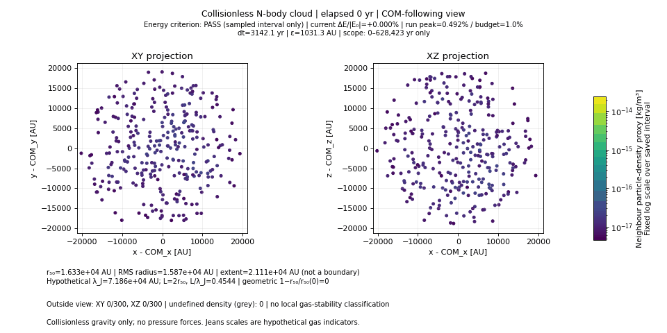
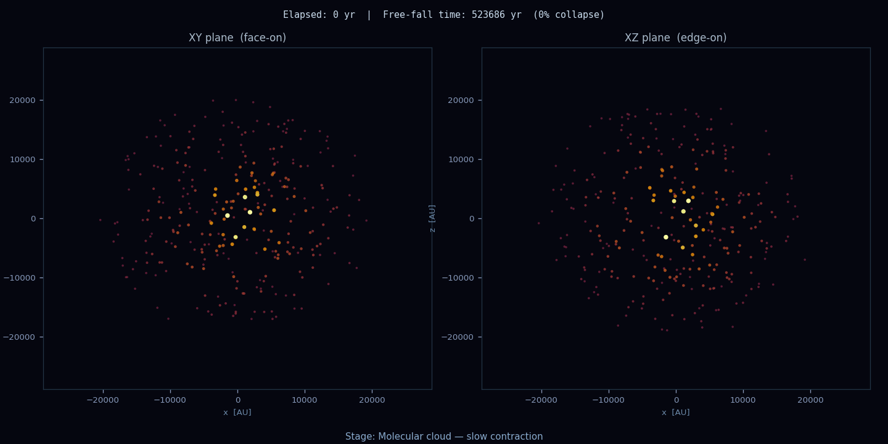

# Star Formation Simulation

The current model is a softened, collisionless gravitational N-body calculation.
It does not evolve gas pressure, temperature, hydrodynamics, or stellar structure.

Phase 2 adds measured COM-centred cloud sizes, enclosed and neighbour-based particle
density estimates, hypothetical Jeans scales, virial and inflow diagnostics, and
scientific visualization of saved data. See the
[Phase 2 scientific diagnostics report](docs/PHASE2_SCIENTIFIC_DIAGNOSTICS.md) for
equations, tests, numerical results, and limitations.

The corrected preview explicitly uses **dt=0.006 initial t_ff for 1.2 initial t_ff**
(628,423 years), reproducing the Phase 1 trajectory with a 0.492% peak energy error.
The legacy timestep's 1.901% failed case is also preserved and visibly marked FAIL.
Passing this short-interval energy criterion does not validate the full legacy movie.



Colours show a **particle-density proxy**, with fixed temporal scaling and units;
they do not show temperature. Jeans indicators are hypothetical gas comparisons:
wavelengths greater than the Jeans length are unstable in idealized uniform-gas
theory, but this gravity-only solver has no pressure force. No star-formation stage
or elapsed-time collapse percentage is assigned.

Run all baseline, numerical, and diagnostic tests:

```sh
.venv/bin/python -B -m unittest discover -s tests -v
```

Render the saved data without running a simulation (the output directory must be new):

```sh
.venv/bin/python -B scientific_visualization.py validation/phase2/dt0.006 \
  --output validation/phase2-new-view --view com --animation
```

Use `--view fixed` for a fixed-origin view; omit `--animation` for static figures.
The original source and MP4/GIF remain unchanged. The historical documentation
below is retained for traceability and is superseded by the Phase 0–2 reports.

<details>
<summary>Historical documentation and original animation — scientifically superseded</summary>

Phase 1 numerical verification is recorded in
[the N-body validation report](docs/PHASE1_NBODY_VALIDATION.md), including analytical
orbit tests, conservation histories, and the legacy timestep's failed 1% energy
error budget. The legacy script and animations remain unchanged.

> **Phase 0 baseline status:** The source and animations below are preserved historical
> artifacts. This is a gravity-only, softened N-body model; its gas/protostar, density,
> temperature, Jeans-stability, and collapse-percentage claims below are not validated.
> The computed initial free-fall time is **523,686 years**, and the last stored frame
> is at **6.781 million years**. See [the Phase 0 baseline record](docs/PHASE0_BASELINE.md)
> for corrected interpretation, reproducibility, tests, and limitations. The original
> documentation remains below for traceability; scientific diagnostics will be corrected
> in a separately authorized phase.
>
> Lightweight checks: `.venv/bin/python -B -m unittest discover -s tests -v`
>
> Running or importing `starformation.py` launches the full calculation and writes
> `star_formation.mp4` in the working directory. Do not run it from the repository
> to test the baseline; the safe validation command above does not render or save media.

A physics-based N-body simulation of gravitational collapse in a molecular cloud, visualizing the process of protostar formation.

**Author:** Eranjana Weerasinghe

## Overview

This simulation models how a cold gas cloud undergoes gravitational collapse to form a protostar. It uses a direct N-body integrator with softened gravity and the leapfrog (Störmer–Verlet) symplectic integrator to ensure energy conservation.

The visualization shows two orthogonal projections (face-on and edge-on) with particle colors and sizes representing local density, transitioning from a cold molecular cloud through various collapse stages until protostar formation.

## 📺 Animation Preview

<div align="center">



*Gravitational collapse of a 1 M☉ molecular cloud over ~120,000 years*

**Left:** Face-on view (XY plane) | **Right:** Edge-on view (XZ plane)

</div>

---

## Features

- **Physically accurate N-body gravity** with softening to handle close encounters
- **Symplectic integrator** (leapfrog) for energy conservation over long timescales
- **Real units** via Astropy (solar masses, parsecs, AU)
- **Dynamic visualization** showing density-dependent particle properties
- **Jeans instability analysis** with real-time Jeans length calculation and display
- **Stage labeling** tracking collapse progression (molecular cloud → protostar)

## Requirements

Install dependencies with:

```bash
pip install astropy matplotlib numpy
```

For video output, FFmpeg must be installed:
- **macOS:** `brew install ffmpeg`
- **Linux:** `apt-get install ffmpeg`
- **Windows:** Download from [ffmpeg.org](https://ffmpeg.org/download.html)

## Usage

Run the simulation:

```bash
python starformation.py
```

The script will:
1. Pre-compute 1080 frames of the gravitational collapse (~1 minute at 18 fps)
2. Generate an animation showing face-on (XY) and edge-on (XZ) views
3. Save output as `star_formation.mp4`

## Simulation Parameters

| Parameter | Value | Description |
|-----------|-------|-------------|
| Cloud mass | 1.0 M☉ | Total initial mass |
| Cloud radius | 0.1 pc ≈ 20,600 AU | Initial cloud size |
| Particles | 300 | Number of gas particles |
| Frames | 1080 | Animation frames (60 sec @ 18 fps) |
| Sound speed | 200 m/s | Pressure support parameter |
| Timestep | 0.012 × t_ff | Adaptive to free-fall time |

## Output

The animation displays:
- **Colors:** Inferno colormap (blue → orange → white) indicating density/temperature
- **Sizes:** Particle size scales with local density
- **Labels:** Real-time elapsed time and collapse percentage
- **Stage info:** Current evolutionary stage of the collapse
- **Jeans length:** Dynamic calculation showing λ_J and comparison with cloud radius
  - When cloud radius < Jeans length, gravitational instability drives collapse

## Physics

The simulation integrates the equations of motion using Newtonian gravity with softening:

$$\frac{d^2\mathbf{r}_i}{dt^2} = -G \sum_{j \neq i} \frac{m_j (\mathbf{r}_i - \mathbf{r}_j)}{(|\mathbf{r}_{ij}|^2 + \epsilon^2)^{3/2}}$$

Where ε is the softening length, preventing gravitational singularities.

## Jeans Instability

The simulation includes real-time **Jeans length** calculation to demonstrate gravitational instability:

$$\lambda_J = \sqrt{\frac{\pi c_s^2}{G \rho}}$$

Where:
- $c_s$ = sound speed (200 m/s for cold clouds)
- $G$ = gravitational constant  
- $\rho$ = local cloud density

**Physical interpretation:**
- When cloud radius **> Jeans length**: Pressure support dominates, cloud is stable
- When cloud radius **< Jeans length**: Gravity dominates, cloud collapses (Jeans instability)

As the simulation progresses, watch how the Jeans length decreases with increasing density, triggering and accelerating the collapse toward protostar formation.

## References

- Free-fall time: ~120,000 years for a 0.1 pc cloud at 1 M☉
- Based on Bonnor-Ebert sphere initial conditions
- Leapfrog integration: Springel et al. 2001, MNRAS 328, 726

</details>
