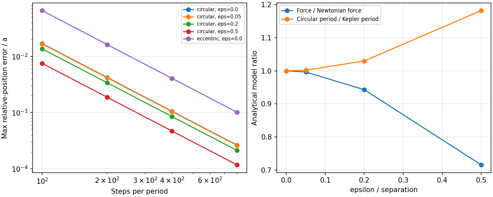
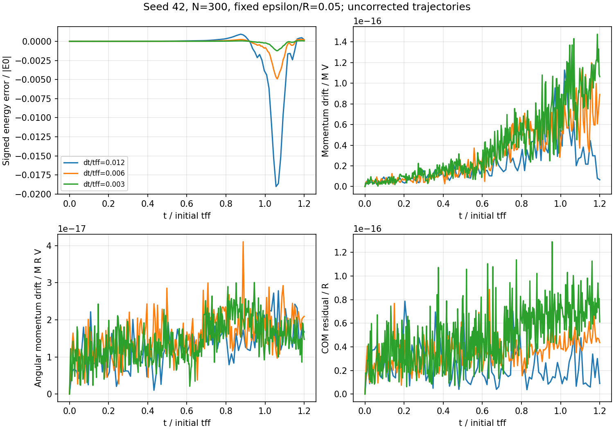

# Phase 1 — Gravitational N-body numerical verification

Date: 2026-10-15. Phase 1 only. The force law and fixed-step KDK implementation
pass isolated verification and demonstrate second-order trajectory convergence.
The legacy cloud timestep **fails the predefined 1% maximum energy-error budget**:
its peak error is 1.9005% during the tested collapse. Halving the step reduces that
peak to 0.4918%; quartering it reduces it to 0.1233%. Neither exact energy conservation
nor long-term accuracy is claimed.

## Implementation summary and preservation

The starting working tree was clean at the accepted Phase 0 commit
`90cccfc0ad5832b84b8b97999a03cc1f97d3440b`. All 10 Phase 0 tests passed before changes.
The historical source/media reference remains
`774d69713da47c5578badb30a5981d80319bd67f`.

`nbody.py` adds explicit-parameter gravity, KDK, and diagnostics alongside the
legacy executable. The arithmetic order for valid floating-point legacy states
is preserved. The original script does not call the new module, and has not been
refactored or changed. Its source, MP4, and GIF still match their Phase 0 hashes.
No hydrodynamics, pressure, thermodynamics, sinks, or new formation labels were added.

New numerical routines take mass, softening, G, and dt explicitly. They reject
malformed/nonfinite inputs, negative softening/G, and nonpositive masses. Integer
inputs are converted to floating point. Unit-bearing arrays must be converted
explicitly by callers. Coincident distinct particles with zero softening and
nonzero G raise an error; no singular values are clipped. G=0 is supported for
free-motion verification. An input acceleration must correspond to the initial
position and parameters; the caller owns that consistency requirement.

## Physical and numerical methods

Inputs use SI: position and softening in m, mass in kg, velocity in m/s,
acceleration in m/s^2, dt in s, and G in m^3 kg^-1 s^-2. The orbit experiments
instead use explicitly consistent dimensionless units with G=M_total=a=1.
No hidden conversion or normalization is applied within the solver.

The preserved acceleration and its corresponding potential are

```text
a_i = G sum_(j != i) m_j (r_j-r_i) / (|r_j-r_i|^2 + epsilon^2)^(3/2)
U   = -G sum_(i<j) m_i m_j / sqrt(|r_j-r_i|^2 + epsilon^2)
```

The acceleration points toward each source particle and depends on the source
mass. Setting the self-distance to infinity excludes self-acceleration; potential
energy sums each distinct pair once and excludes all self terms. Differentiating
U gives F_i = -grad_i U = m_i a_i. Constant softening defines a different
Hamiltonian from point-mass Newtonian gravity, not an integration correction.

Kick–drift–kick (KDK) uses synchronized full-step position/velocity outputs:

```text
v_half = v_n + (dt/2) a_n
r_next = r_n + dt v_half
a_next = a(r_next)
v_next = v_half + (dt/2) a_next
```

At fixed dt this is a second-order, reversible, symplectic map for the separable
softened gravitational Hamiltonian, in exact arithmetic. Floating-point evaluation
introduces rounding error. Symplecticity does not imply exact energy conservation
or accuracy at an underresolved timestep. The fixed-step qualification is also
discussed in the [GADGET-4 code paper, section 5.2](https://wwwmpa.mpa-garching.mpg.de/gadget4/gadget4-code-paper.pdf).
No variable-step scheme is introduced here.

The implemented diagnostics are

```text
K = 1/2 sum_i m_i |v_i|^2                     [J]
E = K + U                                    [J]
P = sum_i m_i v_i                            [kg m/s]
L = sum_i r_i cross (m_i v_i)                 [kg m^2/s]
R_cm = sum_i m_i r_i / sum_i m_i              [m]
V_cm = P / sum_i m_i                         [m/s]
```

K retains bulk kinetic energy; L is about the fixed coordinate origin. No COM
subtraction is performed on evolved states. In an isolated calculation, the
reference COM trajectory is R_cm(0)+t V_cm(0), not a stationary origin.

For histories define M=sum(m), characteristic length R (initial cloud radius or
orbital semimajor axis/separation), and V=sqrt(GM/R). The reported errors are:

```text
delta_E = (E(t)-E(0)) / |E(0)|
delta_P = ||P(t)-P(0)|| / (M V)
delta_L = ||L(t)-L(0)|| / (M R V)
delta_R = ||R_cm(t)-R_cm(0)-t V_cm(0)|| / R
```

P and L use differences of vectors, not differences of their magnitudes. Their
normalizations remain meaningful even when the initial vector is zero. Raw vector
components and raw energies are saved in CSV as well. The energy normalization is
appropriate to these bound, nonzero-energy cases; it is not a general prescription
for marginally unbound systems.

## Predefined acceptance criteria

Criteria were declared before evaluating the experiments and saved in
[`experiments/phase1_config.json`](../experiments/phase1_config.json).

| Check | Criterion | Justification |
| --- | --- | --- |
| Analytical force, hand-computed diagnostics, unit scaling | relative error <= 1e-12 | Allows rounding while detecting sign, mass, unit, and pair-count errors |
| Near-zero force/torque cancellation | absolute error <= 1e-14 in dimensionless O(1) tests | A few dozen machine epsilons; relative error at zero is undefined |
| Potential finite difference | relative error <= 1e-6, central displacement 1e-5 | Allows subtraction and truncation error independently of analytic acceleration |
| Seed-42 legacy regression | relative error <= 1e-12, zero absolute tolerance | Baseline equivalence, not a physical accuracy claim |
| Orbit position convergence | 1.8 <= measured order <= 2.2 | Detects second-order behavior while allowing finite-step deviations |
| Finest orbit position error | max error / a <= 0.002 | Preselected 0.2% trajectory budget over two periods |
| Orbit and cloud energy | max abs(delta_E) <= 0.01 | Preselected 1% engineering accuracy budget, not a universal scientific threshold |
| Momentum/angular momentum/COM | normalized drift <= 1e-10 | Generous rounding allowance across these short trajectories |

Exact comparisons additionally check one-particle self-exclusion, no-gravity
velocities, and the hand-computed case where values are exactly representable.
The cloud energy budget is evaluated without modifying the state or tuning the
tolerance after the result. A failed budget is retained as a negative result.

## Analytical reference cases and isolated verification

1. Two particles at (0,0,0) and (3,4,0), masses 2 and 7, G=1.7, epsilon in
   {0,0.2,2}: force direction and magnitude follow the separation vector and
   denominator (25+epsilon^2)^(3/2). Mass-weighted pair forces cancel.
2. One particle: exactly zero acceleration and potential for epsilon=0 and 0.5.
3. Coincident particles: epsilon=0.5 gives zero pair acceleration and finite
   potential; epsilon=0 explicitly reports a singularity.
4. Three unequal masses: direct pair-sum potential, finite-difference force,
   total force/torque cancellation, and translation/rotation/permutation covariance.
   Maximum componentwise force-gradient relative error across the tested
   softenings is **2.42e-10**, below 1e-6.
5. Hand-computed diagnostic state: r=[(-1,0,0),(2,0,0)],
   v=[(0,2,0),(0,-1,0)], m=[2,1], epsilon=4, G=5 gives
   K=4.5, U=-2, E=2.5, P=(0,3,0), L=(0,0,-6), R_cm=0, V_cm=(0,1,0).
6. Dimensional rescaling: L_unit=3e15 m, M_unit=2e30 kg,
   T_unit=sqrt(L_unit^3/(G_SI M_unit)) compares dimensionless and SI forces,
   integration, energies, momentum, angular momentum, COM, and COM velocity.
7. No-gravity experiment: 100 steps at dt=0.01, G=0, against
   r(t)=r(0)+t v(0). Maximum absolute coordinate error is **3.33e-16** in the
   dimensionless case; velocity error is exactly zero.
8. One-step reversal and explicit KDK update comparison pass. Complete seed-42
   arrays agree with legacy acceleration and three subsequent steps; observed
   agreement is bitwise exact in this environment, stronger than the required tolerance.

These tests measure separate properties; passing short reversibility or momentum
checks alone would not establish trajectory accuracy or long-term stability.

## Analytical two-body orbits and timestep convergence

All cases have m1=0.4, m2=0.6, G=1, and semimajor axis or separation a=1, in the
barycentric frame. Runs cover two full reference periods at 100, 200, 400, and
800 steps per period.

For a circular orbit in the softened potential, the exact relative angular speed is

```text
omega^2 = G(m1+m2)/(a^2+epsilon^2)^(3/2)
r_rel(t) = a (cos(omega t), sin(omega t), 0)
v_rel(t) = a omega (-sin(omega t), cos(omega t), 0)
r1 = -m2/(m1+m2) r_rel; r2 = m1/(m1+m2) r_rel
```

Thus the softened cases are compared to their own exact circular solution, rather
than incorrectly using the Kepler period. Velocities are initialized for each
softened circular orbit. These are a controlled family of equilibrated orbits,
not a claim that changing epsilon preserves the same initial velocities or energy.

For epsilon=0 and eccentricity e=0.3, the independent reference solves Kepler's
equation E_anomaly-e sin(E_anomaly)=n t and uses
r_rel=a(cos(E_anomaly)-e, sqrt(1-e^2) sin(E_anomaly),0). The scalar solve stops
when its Newton increment is below 1e-14 (maximum 30 iterations); it does not
integrate the force equation. This reference is not applied to softened ellipses.

Trajectory error is max_t ||(r2-r1)_numerical-(r2-r1)_exact||/a, measured at every
full timestep. Observed order is log2(error_dt/error_dt/2), at the same physical
end time for a given model.

| Case | 100 steps/period | 200 | 400 | 800 | Order on final halving |
| --- | ---: | ---: | ---: | ---: | ---: |
| Circular, epsilon=0 | 1.68792e-2 | 4.22457e-3 | 1.05643e-3 | 2.64126e-4 | 1.99990 |
| Circular, epsilon=0.05 | 1.66359e-2 | 4.16338e-3 | 1.04113e-3 | 2.60299e-4 | 1.99991 |
| Circular, epsilon=0.2 | 1.35871e-2 | 3.39872e-3 | 8.49812e-4 | 2.12461e-4 | 1.99995 |
| Circular, epsilon=0.5 | 7.51596e-3 | 1.87912e-3 | 4.69787e-4 | 1.17447e-4 | 1.99999 |
| Kepler ellipse, e=0.3 | 6.53038e-2 | 1.62647e-2 | 4.06218e-3 | 1.01529e-3 | 2.00036 |

All measured halving orders lie between 1.99837 and 2.00543: **pass**.
All finest-grid position errors are below 0.002: **pass**.
Largest orbital energy error is 0.00215488 (0.215488%), in the coarsest eccentric
run: **pass**. The finest eccentric run has maximum energy error 3.35374e-5.

Circular-orbit energy errors decrease approximately as dt^4 here because of
special cancellation near circular motion. This does not make KDK a fourth-order
trajectory integrator; the position errors above demonstrate second order.



## Softening sensitivity: physical model versus integration error

At fixed pair separation a, direct force tests give
F_soft/F_Newton=(1+(epsilon/a)^2)^(-3/2). Circular periods obey
T_soft/T_Kepler=(1+(epsilon/a)^2)^(3/4).

| epsilon/a | Force ratio (analytic and measured) | Period ratio (analytic) |
| --- | ---: | ---: |
| 0 | 1 | 1 |
| 0.05 | 0.996261685 | 1.001874415 |
| 0.2 | 0.942866034 | 1.029852445 |
| 0.5 | 0.715541753 | 1.182177011 |

The force measurements agree with their analytic ratios to displayed precision.
Independent timestep sweeps for each epsilon converge to the corresponding
softened circular orbit. The approximately 28.4% force reduction at epsilon/a=0.5
is a model change that cannot be removed by reducing dt; the residual orbital
position errors do decrease with dt. Changing epsilon is therefore not a valid
way to tune energy conservation while claiming an unchanged physical model.

These experiments establish force/orbit softening sensitivity. They do not establish
convergence of the 300-particle cloud with particle count or softening. In particular,
epsilon/R_cloud=0.05 does not imply epsilon/pair-separation=0.05 during collapse.

## Controlled seed-42 cloud trajectory and conservation histories

The initial state comes directly from the hash-checked Phase 0 adapter, including
the actual np.random.seed(42) call, with no recentering. The earlier incorrectly
seeded audit measurements are not reused. Parameters: M=1 nominal solar mass,
R=0.1 pc, N=300, epsilon=0.05 R, initial t_ff=523685.938654 yr. The existing random
velocity dispersion and rotation are preserved. Duration is 1.2 t_ff =
628423.126384 yr, with 100/200/400 steps at dt/t_ff=0.012/0.006/0.003.

Initial measured values:

```text
K0 =  3.313175423542286e32 J
U0 = -5.092092215550545e34 J
E0 = -5.058960461315122e34 J
P0 = (2.4913552986717844e30, 2.4755559140987192e29, 1.176486361566552e30) kg m/s
L0 = (1.3770057046780256e45, 3.531778207160825e45, 1.2644013165352155e46) kg m^2/s
V_cm0 = (1.2529385089992382, 0.12449927706452445, 0.5916719580322414) m/s
```

Every full step, including t=0, is recorded (101/201/401 samples). The stored
initial and final arrays allow independent reanalysis; full particle trajectories
are not stored. Histories include all raw diagnostics and normalized residuals.

| dt/t_ff | Peak abs(delta_E) | Final signed delta_E | Peak time / t_ff | 1% budget |
| --- | ---: | ---: | ---: | --- |
| 0.012 | 0.0190050 (1.90050%) | +2.04525e-4 | 1.056 | **FAIL** |
| 0.006 | 0.00491818 (0.491818%) | +1.86071e-4 | 1.062 | PASS |
| 0.003 | 0.00123296 (0.123296%) | +4.94714e-5 | 1.062 | PASS |

The energy dip near maximum contraction is substantially larger than the final
error. Inspecting only the endpoint would incorrectly approve the legacy timestep
under the chosen budget. Peak-error halving orders are 1.95018 and 1.99599.

Cloud position self-convergence uses RMS over all 900 coordinate components of
the difference between final positions at adjacent resolutions, divided by R:

```text
||r_dt - r_dt/2||_RMS/R   = 7.126033084344545e-4
||r_dt/2 - r_dt/4||_RMS/R = 1.773464516482412e-4
p = log2(first/second)   = 2.006528716462616
```

This is evidence of second-order convergence over the tested interval, not an
exact solution or a guarantee for later chaotic evolution.

| dt/t_ff | Max delta_P | Max delta_L | Max delta_R |
| --- | ---: | ---: | ---: |
| 0.012 | 1.12807e-16 | 2.78370e-17 | 7.86773e-17 |
| 0.006 | 1.19896e-16 | 4.10192e-17 | 8.86515e-17 |
| 0.003 | 1.47479e-16 | 3.00537e-17 | 1.29027e-16 |

All conservation-vector/COM criteria pass. Across the orbit experiments, their
largest respective residuals are 1.61e-15, 1.48e-15, and 1.09e-14, also below
1e-10. Small vector residuals do not compensate for the failed energy budget.



## Validation and regression results

The standard automated suite passes **27 tests**: 10 unchanged Phase 0 tests,
13 isolated force/integration/diagnostic tests, and four orbital verification
tests (the orbit cases are calculated once per test class). The measured final
test run took approximately 0.92 seconds. No unit test is skipped or marked as
an expected failure to hide the cloud result.

The broader experiment ran in approximately 13.50 seconds, recording 20 orbit
configurations and three cloud trajectories. Seven aggregate criteria passed;
`cloud_energy_budget` failed because the coarsest run exceeds 1%. The runner
preserved the output and returned exit status **1**, intentionally exposing this
failed numerical criterion to automation. The tighter cloud steps were not used
to retroactively change the baseline or the budget.

Matplotlib printed a Fontconfig default-cache warning during report figure
generation; it used a temporary Matplotlib cache and both PNG figures were generated
and visually inspected. This was not a numerical failure. Numerical modules and
automated tests do not import Matplotlib or invoke video encoding.

No expensive full 1080-frame simulation or video render was performed. No packages
were installed. The baseline source and media hashes pass, as does `git diff --check`.

## Reproduction and data locations

Run all automated tests from the repository root:

```sh
.venv/bin/python -B -m unittest discover -s tests -v
```

To rerun the bounded experiments, choose a new output directory:

```sh
.venv/bin/python -B experiments/validate_nbody.py --output validation/phase1-rerun
```

The runner refuses an existing directory. Expect exit status 1 with the current
configuration because the recorded cloud criterion fails. It still saves all
completed diagnostic data and the failure list. Never run/import the legacy
`starformation.py` to invoke these checks.

[`validation/phase1/results.json`](../validation/phase1/results.json) records the
executed configuration, Python/dependency/platform versions, Git HEAD and working
tree state, SHA-256 hashes of numerical inputs/source, runtime, criteria, and
failure warnings. The exact environment is Python 3.13.5, NumPy 2.4.4, Astropy
7.2.0, Matplotlib 3.10.8 on arm64 macOS. Code changes were uncommitted during the
run, so input source hashes supplement the accepted baseline commit identifier.

The directory also contains:

- `config.json`: configuration and tolerances copied at execution.
- `cloud_initial.npz`: initial positions [m], velocities [m/s], masses [kg].
- `cloud_final_dt*.npz`: matching final states at 1.2 t_ff.
- `cloud_dt*.csv`: complete per-step conservation histories in SI and normalized errors.
- `cloud_summary.csv`: cloud maxima and final energy errors.
- `orbit_convergence.csv`: all 20 runs, actual dt/period, errors, and measured orders.
- `orbit_circular_eps*.csv`, `orbit_eccentric_eps0.csv`: finest orbit histories in
  dimensionless units (1601 samples each); coarser orbit results are summarized.
- `softening.csv`: analytical model ratios and measured fixed-separation forces.
- `cloud_conservation.png`, `orbits_and_softening.png`: standalone report figures.

The initial cloud fields in the experiment configuration describe the preserved
seeded model; the runner obtains them from Phase 0 rather than offering a new
configurable initial-condition generator. No general experiment framework or
simulation architecture migration is implied.

## Known limitations and recommendations

- The existing force and KDK algorithms are verified for the tested cases, and
  their operation order matches the legacy implementation. This does not validate
  the original physical interpretation as molecular-cloud hydrodynamics.
- The legacy dt=0.012 t_ff fails a 1% energy criterion over the first 1.2 t_ff.
  For this interval, dt=0.006 t_ff meets that particular budget; dt=0.003 t_ff
  provides a stronger reference. Neither is certified over the original 12.948
  t_ff displayed duration. The original timestep remains unchanged.
- No secular-drift claim can be made from two orbits or 1.2 t_ff. Longer runs,
  more seeds, stronger eccentricities, and dense encounter configurations require
  further verification before general accuracy claims.
- Only one particle count and one cloud softening were used. Two-body softening
  sensitivity is established, but cloud particle-count/softening convergence,
  collisional relaxation, and physical spatial resolution remain unresolved.
- Direct gravity and potential diagnostics are O(N^2). No performance acceleration
  or algorithm change is included.
- Strictly positive particle masses and finite floating-point inputs define the
  new module's supported domain; arbitrary unit-bearing arrays, negative masses,
  and unresolved unsoftened collisions are deliberately not silently accepted.
- No energy/momentum renormalization, velocity recentering, clipping, or drift
  correction was applied. COM motion from the actual initial momentum is retained.

Phase 1 concludes with a qualified validation and an explicit failed accuracy
budget, not a blanket endorsement of the legacy run. Phase 2 should expose
measured diagnostics and remove unsupported visualization interpretations once
authorized. It should carry forward these conservation histories and distinguish
timestep accuracy from changes to softening. **Phase 2 has not been implemented.**

## Files changed

Added: `nbody.py`, `experiments/phase1_config.json`, `experiments/validate_nbody.py`,
`tests/test_nbody.py`, `tests/test_orbits.py`, this report, and the recorded
`validation/phase1/` artifacts listed above. README gains only a link to this report.
No Phase 0 tests, fixtures, manifest, or source/media artifacts were modified.
No files were removed.
