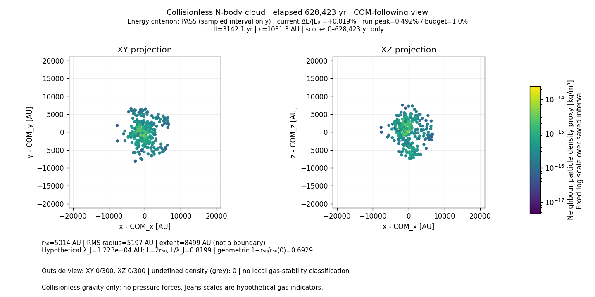

# Phase 2 — Scientific diagnostics and defensible visualization

Phase 2 is implemented and tested for the collisionless N-body model. It introduces
measured cloud diagnostics and a separate visualization of saved data. It does not
add gas pressure, hydrodynamics, temperature evolution, or stellar-formation stages.

## Prerequisites, scope, and preservation

Implementation began with a clean working tree at committed Phase 1 revision
`2f0b815f98eef8bc5f888a28c7073d52f20d50bb`. The Phase 0 manifest, corrected seed-42
fixtures, Phase 1 report, and recorded numerical results were inspected first.
All 27 existing tests passed before changes.

The original `starformation.py`, MP4/GIF, Phase 0 fixtures, Phase 1 numerical
module, tests, and archived results are unchanged. Phase 2 calls the verified
`nbody.py` functions without changing the force law or integration. No initial
velocity recentering, energy adjustment, clipping, or momentum correction is applied.

The primary preview explicitly selects dt=0.006 initial t_ff and ends at
1.2 initial t_ff, the interval tested in Phase 1. A second dataset explicitly uses
dt=0.012 initial t_ff to demonstrate the failed energy criterion. These are short
reproductions of existing experiments, not new full-length simulations. The
legacy default remains unchanged. Neither timestep is certified for the legacy
animation's approximately 13 t_ff duration.

## Files and separation of responsibilities

- `scientific_diagnostics.py`: independently testable measurements and strict JSON serialization.
- `scientific_visualization.py`: validates and reads saved data; produces XY/XZ views,
  scientific figures, and an optional short GIF. It does not integrate a trajectory.
- `experiments/phase2_preview.py`: reproduces an explicitly selected short Phase 1
  run, records every state/diagnostic, and checks against archived Phase 1 results.
- `tests/test_scientific_diagnostics.py`, `tests/test_scientific_visualization.py`:
  analytical, synthetic-distribution, serialization, and deterministic plot tests.
- `validation/phase2/`: saved data, numerical status, provenance, and reviewed figures.
- `README.md`: introduces the current capabilities and visualization; historical
  documentation remains clearly labelled as superseded, without changing Git history.

This is the separation needed for Phase 2; the general packaging/configuration
and orchestration refactor proposed for Phase 3 has not been undertaken.

## Units and implemented equations

All diagnostic inputs and stored particle arrays are numeric SI: m, kg, s, m/s.
Unit-bearing objects must be converted explicitly. Plots use the exact AU
conversion 149597870700 m and a Julian year of 31557600 s. Array shapes, positive
masses, finite input values, and parameter domains are validated. Empty clouds
are rejected. There is no implicit conversion to normalized solver units.

### Centre of mass and radial geometry

For total mass M=sum_i m_i:

```text
R_cm = sum_i m_i r_i / M
V_cm = sum_i m_i v_i / M
s_i = |r_i-R_cm|
R_rms = sqrt(sum_i m_i s_i^2 / M)
r_q = smallest sampled s at which cumulative enclosed mass >= q M
R_extent = max_i s_i
M_aperture(R) = sum_(s_i <= R) m_i
```

`enclosed_mass_radii()` accepts configurable fractions in (0,1]. The half-mass
radius uses q=0.5. These are discrete mass quantiles, not number percentiles or
interpolated radii. All particles on a tied shell are counted as enclosed, so
the actual mass inside r_q may exceed qM. `R_extent` is an extent statistic,
not a physical gas boundary; it is sensitive to outliers. All radii and apertures
follow the measured COM even when the projection uses fixed-origin coordinates.

### Global and local particle density

The reported effective-volume mean density is

```text
rho_half = M(s_i <= r50) / [(4*pi/3) r50^3].
```

The numerator is the **actual enclosed mass**, not the total cloud mass placed
inside a smaller radius. This describes a COM-centred enclosing sphere. It is
not necessarily the density of either component of a fragmented distribution.
Zero r50 gives an undefined density, recorded as JSON null, not a finite floor.

For local density, exclude the target particle and locate its kth neighbour at
distance d_k. Let M_k be the mass of k neighbours. The implemented proxy is

```text
rho_i = [(k-1)/k] M_k / [(4*pi/3) d_k^3], with 2 <= k < N.
```

For an exact distance tie on the kth shell, neighbours strictly inside are fully
weighted and all shell neighbours share the remaining count weight. This prevents
unequal-mass ties from depending on particle ordering. Preview data use k=16;
the controlled uniform-distribution benchmark uses k=32. The support radius d_k
is saved and is distinct from gravitational softening and any SPH smoothing length.

Justification: for equal-mass homogeneous Poisson sampling, the random variable
n V_k follows a Gamma(k,1) distribution, giving E[1/V_k]=n/(k-1). Multiplication
by (k-1), rather than k, removes this inverse-volume bias. Unequal masses use the
neighbour mean mass and require locally representative mass sampling; this is not
a general unbiased estimator for mass-segregated or strongly varying populations.
Nearest-neighbour density methods also face a smoothing-bias/variance tradeoff
in nonuniform distributions, discussed by [Wozniak and Kruszewski](https://arxiv.org/abs/1301.5346).
The formula, tie treatment, and assumptions above define this implementation;
no external density-estimator code was imported.

Boundary and gradient corrections are **not** implemented. A large k reduces
sampling noise but can blend structures. A zero d_k produces NaN in the numeric
particle field, explicit undefined counts/warnings in the report, and grey markers
in the view. There is no floor at the gravitational softening length. These are
collisionless particle-density proxies, not hydrodynamically evolved gas densities.

### Jeans indicators and free-fall reference

For explicitly supplied positive c_s, rho, and G:

```text
lambda_J = sqrt(pi c_s^2 / (G rho))
M_J = (4*pi/3) rho (lambda_J/2)^3
t_ff = sqrt(3*pi / (32 G rho))
```

The saved mean-density indicators use rho_half. The plotted characteristic length
is the **current diameter L=2 r50**, and the comparison is L/lambda_J. A hypothetical
uniform gas perturbation with wavelength greater than lambda_J is Jeans-unstable;
the reversed inequality in the historical README does not apply. The derivation
follows omega^2=c_s^2 k^2-4*pi*G*rho and lambda=2*pi/k, as described in
[David Tong's structure-formation notes](https://www.damtp.cam.ac.uk/user/tong/cosmo/cosmohtml/S3.html).

An enclosing diameter is not an identified eigenmode of this finite, nonuniform
cloud. The ratio is therefore labelled a hypothetical gas indicator, without
classifying the actual cloud as globally or locally stable/unstable. The sound
speed, still 200 m/s for the preview, has no dynamical effect: the solver contains
no pressure acceleration. Crossing a Jeans threshold does not trigger any action.
Undefined rho_half gives undefined Jeans scales. The diagnostic t_ff computed
from changing rho_half is distinct from the fixed initial full-sphere t_ff used
to specify the numerical run and its duration.

### Kinetic, potential, and virial measurements

The Phase 1 definitions of total kinetic energy K, softened pair potential U,
total energy E, momentum P, and angular momentum L about the origin are reused.
Additional measurements are

```text
K_bulk = 1/2 M |V_cm|^2
K_internal = 1/2 sum_i m_i |v_i-V_cm|^2
K = K_bulk + K_internal
W = sum_i m_i (r_i-R_cm) dot a_i
  = -G sum_(i<j) m_i m_j r_ij^2 / (r_ij^2+epsilon^2)^(3/2)
Q_U = 2 K_internal / |U|
Q_W = 2 K_internal / |W|
```

W is the force virial, not the softened potential energy. For nonzero softening
W differs from U. Both ratios are saved with distinct labels. In an isolated
system, one-half the second derivative of the COM-frame moment of inertia is
2K_internal+W. Thus a time-dependent contracting/rebounding cloud cannot be
declared equilibrated from a ratio alone. Ratios with zero denominator are null.
Uniform bulk motion is diagnosed, not removed from the integrated state.

### Concentration, contraction, and inflow

```text
C_half(t) = 1 - r50(t)/r50(0)
concentration = r50/r90
v_radial,i = [(r_i-R_cm) dot (v_i-V_cm)] / s_i
f_inflow = mass with v_radial < 0 / total mass
```

C_half is a dimensionless geometric contraction measure. It can be negative for
expansion and is not clipped; it is not elapsed-time percentage, accreted mass,
or fraction of a star formed. A zero reference r50 makes it undefined. A smaller
r50/r90 indicates greater central concentration under this particular radius
definition, without identifying a physical core.

The preview also tracks mass inside the fixed physical aperture R_initial/2,
centred on COM. At s_i=0 the radial direction is undefined; such particles have
NaN radial velocity and their mass is excluded from the mean radial velocity.
The report includes the mass fraction with a defined radial direction. The
inflow fraction retains total mass as its denominator. Exactly zero radial
velocity is not counted as inflow; very small values can be sensitive to rounding.

## Numerical accuracy and serialization

The existing Phase 1 normalizations are retained:

```text
delta_E(t) = [E(t)-E0]/|E0|
peak_E(t) = max_(samples <= t) |delta_E|
delta_P = |P(t)-P0|/(M V)
delta_L = |L(t)-L0|/(M R_initial V)
delta_COM = |R_cm(t)-R_cm(0)-t V_cm(0)|/R_initial
V = sqrt(G M/R_initial)
```

The predefined energy budget is 1%. A failure anywhere in the saved interval is
reported on **every** animation frame, even if the current error is smaller.
The status is explicitly an energy criterion, not a universal validation label.
All integration steps are recorded in the two preview datasets, including t=0.
The code will label a general dataset only over its supplied samples and never
infer accuracy between sparse samples or beyond its end time.

`trajectory.npz` stores positions, velocities, masses, times, per-particle density,
neighbour radius, and radial velocity. `diagnostics.json` stores scalar/vector
histories, definitions, explicit numerical parameters, sample interval, warning
strings, source/version provenance, and the trajectory SHA-256. Undefined values
are JSON null; nonstandard JSON NaN is not emitted. NumPy NaNs are retained only
in explicitly undefined particle diagnostics.

The loader verifies the trajectory hash, dimensions, finite states, positive
masses, time ordering, timestep/interval agreement, COM consistency with the
particles, energy error history, peak error, and accuracy label. Plotting cannot
silently turn a failing energy history into a passing label. These checks do not
replace regeneration/independent checking of every derived quantity in externally
supplied datasets. Output directories and JSON files use exclusive creation.

## Acceptance criteria and actual test results

Acceptance criteria were stated before implementation: analytical diagnostics
within 1e-12 relative tolerance (or 12-place checks for dimensionless hand cases),
uniform-cloud interior mean-density error <=10%, exact finite JSON/array round
trips, and deterministic plot structure/labels/scales. The controlled discrete
uniform sphere has a separate 0.1% sampling tolerance against continuum radii,
declared in its test before execution; it is not an exact continuum quadrature.

**53 automated tests pass**: 27 unchanged Phase 0/1 tests and 26 new tests
(17 diagnostic tests, nine visualization tests). The recorded full run took
approximately 9.44 s, including temporary font-cache initialization.

| Case | Measurement | Result |
| --- | --- | --- |
| Unequal masses 3:1 at x=-1,3 | COM=0, RMS=sqrt(3), r50=1, actual enclosed mass=3 | Pass; measured RMS/density relative errors 0 |
| Tied mass shell | Actual mass within r50, not nominal 0.5M | Pass |
| Analytic Jeans example rho=2,c_s=3,G=4 | lambda=3 sqrt(pi/8), spherical M_J | Pass; measured relative errors 0 |
| Softened circular binary epsilon/separation=0.5 | Q_W=1, Q_U=0.8 | Pass; distinguishes W from U |
| Boost/translation, contracting/expanding/zero-velocity clouds | Internal K/radii invariant; inflow signs and negative contraction correct | Pass |
| Uniform antipodal sphere, 2000 particles | r50 continuum relative error 3.33445e-4; RMS error 4.55427e-7 | Pass, both below 1e-3 |
| Uniform random cube, 2048 particles, seed 2026, k=32 | 706 interior samples; mean density=1.038938 versus true 1 | Pass, error 3.89381% <10% |
| Same cube, all particles including edges | Mean=0.829115 versus true 1 | 17.0885% low; boundary-bias limitation, not an accepted whole-volume accuracy claim |
| Fragmented two-clump cloud | Median local density >1e6 times global enclosing density | Pass; global and local measures remain distinct |
| Identical positions | Undefined density/Jeans/radial direction; grey markers, no invented scale | Pass |
| Serialization/hash/mislabelling checks | Exact finite round trip; null for undefined; reject incorrect hashes/status/COM/interval | Pass |
| Rendering | Correct XY/XZ offsets and AU units; fixed temporal colour range; clipping notices; no unsupported stage labels | Pass |

The uniform cube's interior subset requires each kth-neighbour sphere to lie
inside the known cube: abs(x_j)+d_k<0.5 in all coordinates. This selection removes
edge-truncated spheres but is itself dependent on measured support radius; the
reported residual is an empirical test for this realization, not a proof of
unbiasedness for finite samples. The interior standard deviation is 0.18394;
individual particle density estimates are noisy even when the mean is accurate.
The preview's k=16 uses less smoothing and is not promised the same variance as
the k=32 benchmark. Unequal-mass hand cases and tied-shell permutation tests are
separate from the equal-mass statistical benchmark.

Invalid/empty arrays, negative masses, invalid fractions/k values, nonpositive
Jeans inputs, and zero reference contraction radius are tested. Degenerate valid
states are distinguished from malformed inputs. No failed numerical criterion
was suppressed. The expected legacy energy failure remains a nonzero exit from
the preview generator after saving its data.

## Measured short-run results

Both datasets reproduce the corrected seed-42 Phase 1 initial state exactly.
Their entire total-energy histories have **zero measured relative difference**
from the corresponding Phase 1 CSV, and final positions/velocities pass the
1e-12 relative, zero absolute tolerance regression. Both end at 628423.126384 yr.

| Run | States | Timestep [yr] | Peak relative energy error | 1% criterion |
| --- | ---: | ---: | ---: | --- |
| dt/t_ff=0.006 | 201 | 3142.115632 | 0.0049181773 (0.491818%) | PASS on sampled interval only |
| dt/t_ff=0.012 | 101 | 6284.231264 | 0.0190050081 (1.900501%) | FAIL; results retained |

For the primary 0.006 run:

| Diagnostic | Initial | At 1.2 t_ff |
| --- | ---: | ---: |
| Half-mass radius [AU] | 16325.5213 | 5013.5866 |
| Mean enclosed-half density [kg/m^3] | 1.62933315e-17 | 5.62555676e-16 |
| Hypothetical Jeans length [AU] | 71857.4351 | 12229.0833 |
| (2 r50)/lambda_J | 0.454386 | 0.819945 |
| Q_U=2K_internal/abs(U) | 0.0129374 | 1.3764591 |
| Q_W=2K_internal/abs(W) | 0.0131086 | 1.5293326 |
| Aperture mass fraction, radius R_initial/2 | 0.133333 | 1.0 |
| Inflow mass fraction | 0.556667 | 0.16 |
| Mean COM-frame radial velocity [m/s] | -1.16265 | +196.61873 |
| Geometric contraction C_half | 0 | 0.692899 |

The minimum measured r50 is 2183.2791 AU, with peak geometric contraction 0.866266.
The cloud subsequently re-expands: the last state has mostly outward radial
motion despite being smaller than the initial cloud. This is a measured feature
of the collisionless trajectory, not a protostar classification. The hypothetical
Jeans ratio peaks at 1.24252, but no pressure force reacts to that crossing.

Bulk kinetic energy begins at 1.92421474e30 J (about 0.581% of total K). Across
the primary run, the maximum relative error in K=K_internal+K_bulk is 4.21e-16.
Maximum normalized momentum, angular-momentum, and COM residuals are respectively
1.20e-16, 4.10e-17, and 8.87e-17. No density estimates are undefined in these two
specific trajectories. That does not eliminate sampling or boundary bias.

## Corrected visualization



- Equal-aspect XY and XZ projections show all particle positions in AU. There is
  no unsupported face-on/edge-on disk interpretation.
- Marker areas are constant. Colour is neighbour particle-density proxy [kg/m^3]
  with a labelled logarithmic colour bar, not temperature or radial brightness.
- The colour scale is fixed over **all saved frames** of a dataset. Primary scale:
  4.59931e-18 to 2.40736e-14 kg/m^3. COM and fixed-origin views of that dataset
  share these limits. Separate datasets can have different scales; consult the
  colour bars/metadata rather than treating colours as identical across runs.
- View selection supports COM-following and fixed-origin coordinates. Axes use
  a fixed range covering the whole saved trajectory by default. An explicitly
  smaller API view shows out-of-view counts in each projection on every frame.
- Undefined local densities are grey and counted. If every estimate is undefined,
  no colour bar or fabricated numeric density scale is created.
- Elapsed time, dt, epsilon, current/peak energy error, threshold, and tested
  interval are visible. A failed run remains visibly red/FAIL on all frames.
- Radius/Jeans annotations use current measured quantities and specify L=2r50.
  Geometric contraction is labelled by its definition. No time-based percentage,
  temperature inference, accretion claim, or protostar-birth label is present.
- A separate nine-panel scientific figure shows energy, errors, conservation,
  radii, density, virial ratios, bulk/internal kinetic energy, inflow/aperture mass
  fractions, contraction, and the hypothetical Jeans ratio.

The new GIF contains 21 uniformly selected saved frames at 5 fps, representing
the short tested interval. Numerical criteria are computed from **every** saved
step, not the downsampled animation. The GIF is a diagnostic preview, not the full
legacy movie. Existing MP4/GIF files were never overwritten.

Visual inspection found overlapping axis labels and annotations in the first
export. The layout was corrected and a bounding-box regression test added. Early
exports were moved to a temporary review directory; final exports were generated
in fresh output directories. A Fontconfig cache warning occurred during tests;
the headless plots completed using temporary Matplotlib caches. There were no
scientific test failures in Phase 2; the Phase 1 failed-energy example is retained.

## Running and reviewing the results

All tests, including Phase 0/1 regression:

```sh
.venv/bin/python -B -m unittest discover -s tests -v
```

Render the existing saved dataset into a **new** output directory, without simulation:

```sh
.venv/bin/python -B scientific_visualization.py validation/phase2/dt0.006 \
  --output validation/phase2-new-view --view com --animation
```

Omit `--animation` for only PNG figures; use `--view fixed` for fixed-reference
projections. To reproduce the short primary dataset, choose a new directory:

```sh
.venv/bin/python -B experiments/phase2_preview.py --dt-fraction 0.006 \
  --output validation/phase2-new-data
```

The timestep is required explicitly. Duration is fixed to 1.2 initial t_ff.
Selecting 0.012 saves the result and returns exit status 1 for the failed energy
budget. The generator is deliberately limited to the three Phase 1 tested steps;
it does not offer an unvalidated full-length run. Do not import/run the legacy
script to use this workflow.

Recorded outputs include `dt0.006/`, `dt0.012/`, `view-com/`, `view-fixed/`, and
`view-failed/`. JSON provenance records source hashes, Git revision, software
versions, explicit configuration, warning definitions, and regression results.
View metadata records its input JSON hash, rendering-source hash, axis extent,
colour range, and frame selection. The environment remains Python 3.13.5,
NumPy 2.4.4, Astropy 7.2.0, and Matplotlib 3.10.8; no packages were installed.

## Remaining limitations and Phase 3 recommendation

These diagnostics describe collisionless dynamics. They cannot establish gas
stability, realistic gas fragmentation, hydrostatic protostar formation, or
accretion physics. Enclosed-sphere measures can include empty space between
fragments; COM need not coincide with a density peak. Neighbour density remains
noisy, boundary-biased, and smoothing-dependent. No core classifier is introduced.

The primary run meets the stated short-interval energy budget; the legacy step
does not. Neither result validates a longer trajectory. Gravitational softening,
neighbour support radius, and actual resolved physical scales remain distinct.
No interpretation hides the existing force-resolution or timestep limitations.

Phase 3 should formalize configuration and units, package the simulation/analysis/
rendering boundaries, and provide a stable versioned data schema and entry points
while retaining these reference fixtures and source hashes. Larger-scale sweeps,
alternative density estimators/boundary treatments, and longer numerical accuracy
studies would require explicit experiment scope. Phase 3, SPH, thermal modelling,
and sink development have not begun.
